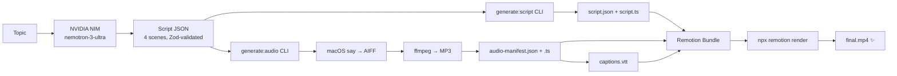

# AI Video Generator 🎬

> **End-to-end AI pipeline** that turns a topic into a polished vertical video (1080×1920, 30fps, 20s) with synchronized narration and captions — built with Remotion, NVIDIA NIM, and macOS native TTS.

<p align="center">
  
  
  
  
  
  
</p>

<p align="center">
  
  
  
</p>

---

## 🎯 What It Does

| Input | Output |
|-------|--------|
| A **topic string** (e.g., `"AI in Gaming"`) | **MP4 video** (1080×1920, 30fps, 20s) with:<br>• 4 animated scenes<br>• Kinetic typography<br>• Synchronized narration audio<br>• WebVTT captions |

**Zero manual editing** — the entire pipeline runs from CLI:

```bash
cd video
npm run generate:script "AI in Gaming"   # 1️⃣ LLM writes structured script
npm run generate:audio                   # 2️⃣ macOS `say` + ffmpeg → audio + captions
npx remotion render PixelPulseShort out.mp4 --enforce-audio-track  # 3️⃣ Remotion renders final video
```

---

## 🏗 Architecture



### Key Design Decisions

| Layer | Technology | Why |
|-------|------------|-----|
| **LLM** | NVIDIA NIM (OpenAI-compatible) | Structured JSON output, single provider |
| **TTS** | macOS `say` + ffmpeg | Free, offline, high-quality voices |
| **Video** | Remotion 4.x | React-based, frame-accurate, programmatic |
| **Validation** | Zod v4 | Runtime schema safety |
| **Config** | JSON + TS modules | Bundle-time + runtime compatibility |

---

## 📋 Prerequisites

| Tool | Version | Install |
|------|---------|---------|
| **Node.js** | ≥20.19 | `brew install node@20` |
| **npm** | ≥10 | Included with Node |
| **ffmpeg** | ≥6.0 | `brew install ffmpeg` |
| **macOS** | Any | Native `say` command |
| **NVIDIA NIM API Key** | — | See [Setup](#-setup) |

> ⚠️ **macOS required** for TTS. Linux/Windows users: swap `say` for `piper`, `coqui`, or cloud TTS in `src/services/ttsGenerator.ts`.

---

## 🚀 Setup

```bash
# 1. Clone & enter
git clone <your-repo>
cd ai-code-video-test/video

# 2. Install deps
npm i --loglevel=error

# 3. Configure NVIDIA NIM
cp .env.example .env   # Create .env with your credentials
# Edit .env:
# NVIDIA_NIM_API_KEY=your_key_here
# NVIDIA_NIM_BASE_URL=https://integrate.api.nvidia.com/v1
# NVIDIA_NIM_MODEL=nvidia/nemotron-3-ultra-550b-a55b

# 4. Verify ffmpeg & say
ffmpeg -version
say "Hello world"  # Should speak
```

### .env.example

```bash
# NVIDIA NIM (required for script generation)
NVIDIA_NIM_API_KEY=
NVIDIA_NIM_BASE_URL=https://integrate.api.nvidia.com/v1
NVIDIA_NIM_MODEL=nvidia/nemotron-3-ultra-550b-a55b

# Optional TTS overrides
TTS_VOICE=Samantha
TTS_RATE=200
```

---

## ⚡ Commands

| Command | Description |
|---------|-------------|
| `npm run dev` | 🎞 Open Remotion Studio (live preview) |
| `npm run generate:script "topic"` | 🤖 Generate script via NVIDIA NIM |
| `npm run generate:audio` | 🎙 Generate narration + captions |
| `npm run generate:all "topic"` | 🔄 Run both steps above |
| `npm run build` | 📦 Bundle for production |
| `npx remotion render PixelPulseShort out.mp4 --enforce-audio-track` | 🎬 Render final MP4 |
| `npm run lint` | 🔍 ESLint + TypeScript check |

### Quick Start (One-liner)

```bash
npm run generate:all "AI in Gaming" && npx remotion render PixelPulseShort output/my-video.mp4 --enforce-audio-track
```

---

## 🔄 Pipeline Deep Dive

### 1. Script Generation (`generate:script`)

```typescript
// src/cli/generateScript.ts
const script = await generateScriptWithRetry({ topic, customPrompt });
```

**Output:** `src/generated/`
- `script.json` — Raw validated JSON
- `script.ts` — ES module export for browser
- `composition-config.json` — Shared config for Remotion

**Script Schema (Zod):**
```typescript
interface VideoScript {
  title: string;
  durationFrames: 600;      // 20s @ 30fps
  fps: 30;
  width: 1080;
  height: 1920;
  scenes: ScriptScene[4];   // Exactly 4 scenes
  metadata: { model, generatedAt, prompt, version };
  globalNarration: string;
}
```

### 2. Audio Generation (`generate:audio`)

```typescript
// src/services/ttsGenerator.ts
const manifest = await generateAudioForScript(scenes, { voice: "Samantha", rate: 200 });
```

**Process per scene:**
1. `say -v Samantha -r 200 -o scene.aiff "narration text"`
2. `ffmpeg -i scene.aiff -c:a libmp3lame -b:a 128k scene.mp3`
3. `ffprobe` → exact duration (ms) → frame mapping

**Output:** `src/generated/`
- `audio/scene-{0..3}-{timestamp}.mp3`
- `audio-manifest.json` + `.ts` module
- `captions.vtt` — WebVTT synchronized to frames

### 3. Video Rendering (`Short.tsx`)

```tsx
// Receives script + audioManifest via defaultProps
const scenes = script?.scenes ?? fallbackScenes;
const scene = scenes[Math.floor(frame / 150)];
```

- **Dynamic scenes** from script (not hardcoded)
- **AudioPlayer** reads manifest → plays correct segment per frame
- **Visual debug banner** shows `GENERATED: {title}` (green) or `FALLBACK` (red)

---

## 📁 Project Structure

```
video/
├── src/
│   ├── cli/
│   │   ├── generateScript.ts      # NVIDIA NIM → script.json/.ts
│   │   └── generateAudio.ts       # macOS say + ffmpeg → audio/
│   ├── components/
│   │   └── AudioPlayer.tsx        # Frame-synced audio playback
│   ├── config/
│   │   └── video.ts               # Colors, durations, constants
│   ├── data/
│   │   └── sampleScript.ts        # Fallback script (never used if pipeline works)
│   ├── generated/                 # 📦 AUTO-GENERATED (gitignored)
│   │   ├── script.json / .ts
│   │   ├── audio-manifest.json / .ts
│   │   ├── composition-config.json
│   │   ├── captions.vtt
│   │   └── audio/*.mp3
│   ├── services/
│   │   ├── scriptGenerator.ts     # NIM chat completion + validation
│   │   └── ttsGenerator.ts        # TTS orchestration
│   ├── types/
│   │   └── script.ts              # Zod schemas (VideoScript, AudioManifest…)
│   ├── Composition.tsx            # Bundle-time metadata (calculateMetadata)
│   ├── Root.tsx                   # Remotion entry point (registers Composition)
│   ├── Short.tsx                  # Main video component
│   └── index.ts                   # registerRoot(RemotionRoot)
├── output/                        # 📦 Rendered MP4s (gitignored)
├── remotion.config.ts             # Rspack config
├── tsconfig.json
└── package.json
```

---

## 🎨 Customization

### Change Visual Theme
Edit `src/config/video.ts`:
```typescript
export const VIDEO_CONFIG = {
  colors: {
    bg: "#080816",
    white: "#F5F5F5",
    cyan: "#00EBFF",
    violet: "#9B7BFF",
    muted: "#6B6B8A",
  },
  sceneDurationFrames: 150,
  durationInFrames: 600,
};
```

### Change TTS Voice
```bash
# List voices: say -v "?"
npm run generate:audio -- --voice "Alex" --rate 180
```

### Change Video Dimensions
Update `VIDEO_CONFIG` and `VideoScript` schema — all dimensions flow from there.

---

## 🐛 Troubleshooting

| Issue | Fix |
|-------|-----|
| `Missing script: generate:script` | Run from `video/` directory, not repo root |
| `Cannot find module './generated/script'` | Run `npm run generate:script` first |
| Audio missing in output | Use `--enforce-audio-track` flag on render |
| `say` command not found | macOS only — install ffmpeg: `brew install ffmpeg` |
| NIM API 401/429 | Check `.env` key, verify quota at NVIDIA dashboard |
| TypeScript errors on `fs`/`path` | Ensure imports only in Node-only files (CLI, Composition.tsx) |
| Green banner shows `FALLBACK` | `generate:script` + `generate:audio` not run, or config stale |

### Debug Checklist

```bash
# 1. Verify generated files exist
ls -la src/generated/

# 2. Check script is valid JSON
cat src/generated/script.json | jq '.scenes | length'  # Should be 4

# 3. Verify audio manifest
cat src/generated/audio-manifest.json | jq '.segments | length'  # Should be 4

# 4. Test render with verbose output
npx remotion render PixelPulseShort out.mp4 --enforce-audio-track --log-level verbose
```

---

## 📄 License

MIT License — see [LICENSE](../LICENSE) for details.

> **Note:** Remotion requires a [company license](https://www.remotion.dev/pricing) for commercial use (revenue >$100k/yr or team >3). Personal/educational use is free.

---

## 🙏 Credits

- **Remotion** — Programmatic video in React
- **NVIDIA NIM** — Nemotron 3 Ultra for structured generation
- **Zod** — TypeScript-first schema validation
- **macOS `say`** — Surprisingly great free TTS

---

<p align="center">
  <strong>Built with ❤️ for developers who hate manual video editing.</strong>
</p>